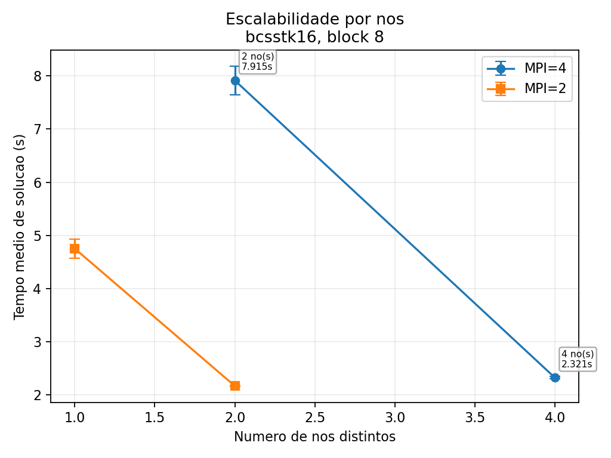
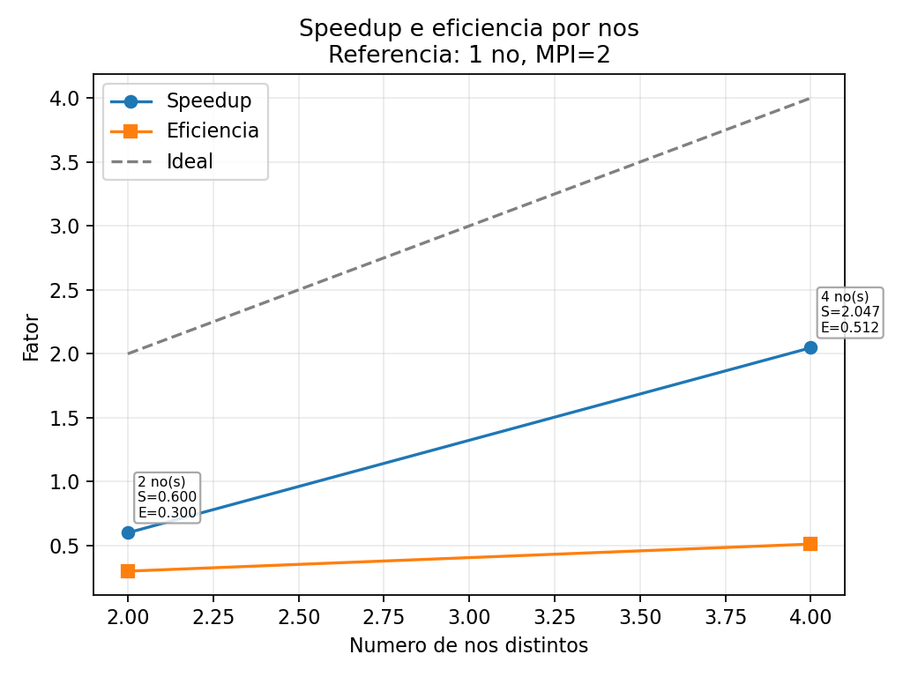
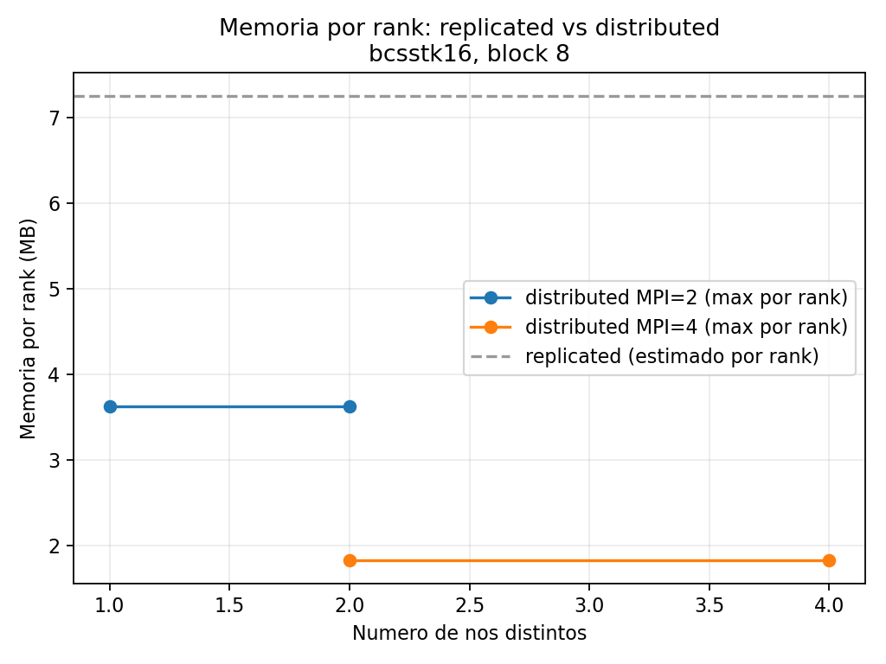
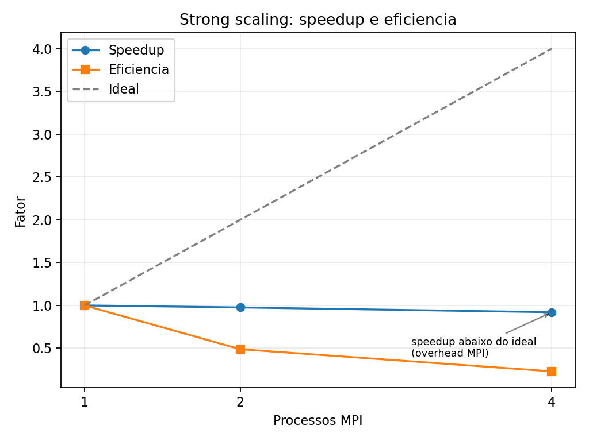
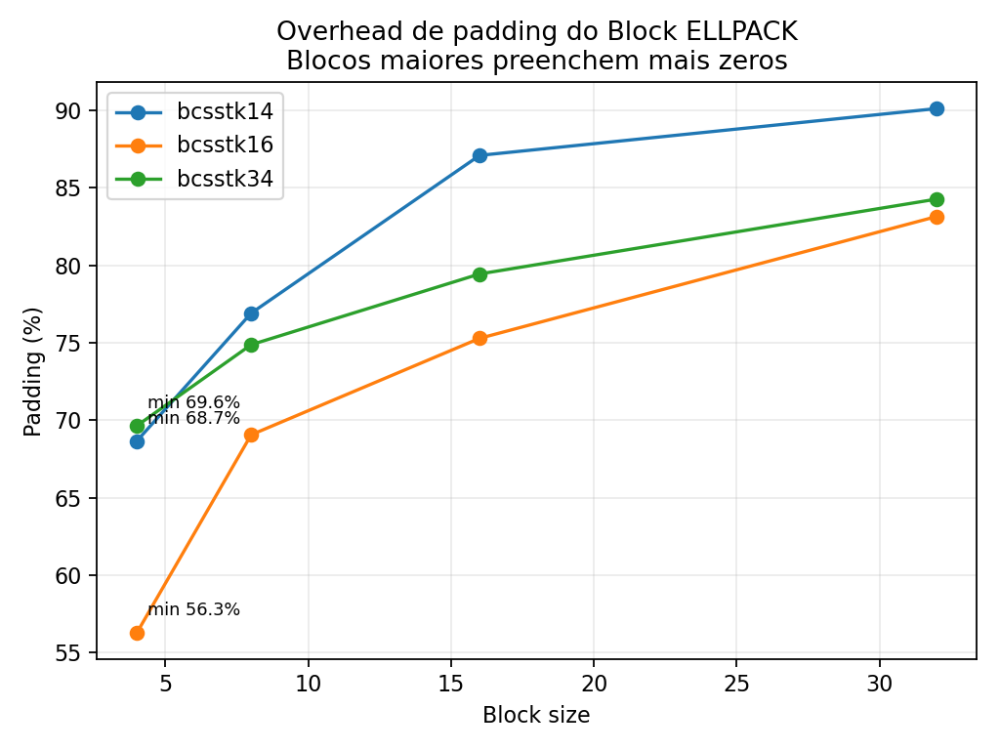

# Gradiente Conjugado Distribuído com Block ELLPACK

## Resumo

Este trabalho implementa o método do Gradiente Conjugado distribuído para
sistemas lineares esparsos, simétricos e definidos positivos. A matriz é
armazenada em Block ELLPACK, as linhas são distribuídas entre processos MPI e
as operações locais usam OpenMP. Foram entregues duas variantes do solver:

- `cg_mpi` **(replicated):** cada processo armazena a matriz inteira e usa
  `MPI_Allgatherv` para reunir o vetor global a cada iteração.
- `cg_mpi_distributed` **(distributed):** cada processo armazena apenas as
  linhas locais do Block ELLPACK e troca somente as colunas necessárias via
  `MPI_Alltoallv` seletivo.

Foram executadas 54 configurações da campanha principal, 12 configurações do
experimento de escalabilidade por nós (replicated) e 12 configurações
comparativas da variante distributed, todas com 3 repetições válidas, no
cluster TVBox.

Os resultados mostram que o solver atingiu o critério de tolerância em todas
as execuções. Para a matriz `bcsstk16`, o aumento de threads OpenMP reduziu o
tempo médio de 2,170 s para 1,500 s, speedup de 1,447x. A escala MPI em um
único nó não apresentou ganho. Entretanto, ao distribuir os processos entre
nós distintos, o speedup atinge 2,19x com `2 nós` e 2,05x com `4 nós` para a
variante replicada. A variante distribuída melhora esses números para
**3,12x com 2 nós** e **3,65x com 4 nós**, reduzindo também a memória por rank
de ~7,25 MB para 1,82 MB.

## Ambiente

Os experimentos foram executados no contexto `tvbox-k3s`, em um cluster k3s
com 11 nós. Nove nós estavam `Ready` durante a campanha; dois permaneceram
`NotReady`. Os nós selecionados para a imagem ARM64 possuem quatro CPUs e
aproximadamente 1,8 GiB de memória disponível.

| Item | Configuração |
|---|---|
| Kubernetes | v1.36.4+k3s1 |
| Arquitetura | ARM64 |
| MPI | MPICH via MPI Operator v0.8.2 |
| OpenMP | `-fopenmp`, `schedule(static)` |
| BLAS | OpenBLAS disponível na imagem |
| Imagem | `srmarinho/cg-mpi:arm64` |
| Tolerância | `1e-8` |
| Máximo de iterações | `10000` |

O código foi compilado na imagem ARM64 com `mpicxx`, OpenMP e OpenBLAS. As
operações vetoriais do CG são implementadas diretamente em C++ com OpenMP.

## Datasets e problema físico

Os dados usados neste trabalho são matrizes de rigidez estrutural da UF Sparse
Matrix Collection, atualmente conhecida como SuiteSparse Matrix Collection.
Elas não são tabelas de observações ou imagens: são modelos numéricos
resultantes de discretizações de estruturas de engenharia. Cada linha e cada
coluna representa um grau de liberdade do modelo, e cada valor representa a
interação entre dois graus de liberdade.

| Dataset | Problema original | Dimensão | Entradas no arquivo | `nnz` expandido | Densidade expandida |
|---|---|---:|---:|---:|---:|
| `bcsstk34` | Matriz de rigidez de um problema de flambagem NASTRAN da Boeing | 588 x 588 | 11.003 | 21.418 | 6,195% |
| `bcsstk14` | Matriz de rigidez do teto do Omni Coliseum, Atlanta | 1.806 x 1.806 | 32.630 | 63.454 | 1,945% |
| `bcsstk16` | Matriz de rigidez de uma barragem do Corps of Engineers | 4.884 x 4.884 | 147.631 | 290.378 | 1,217% |

Os três arquivos possuem cabeçalho Matrix Market:

```text
matrix coordinate real symmetric
```

Isso significa que os valores são reais, estão armazenados em coordenadas
`(linha, coluna, valor)` e a matriz é simétrica. O arquivo armazena apenas a
parte triangular. Durante a leitura, o programa expande cada entrada fora da
diagonal:

```text
A[i][j] = valor
A[j][i] = valor
```

A diagonal não é duplicada. Por isso, a quantidade de entradas do arquivo
original é menor que o `nnz` usado pelo solver depois da expansão. Essa
expansão é necessária para que o produto matriz-vetor represente a matriz
completa usada pelo Gradiente Conjugado.

O problema numérico resolvido é:

```text
A x = b
```

Para validar o solver, o projeto define uma solução conhecida `x_true` como um
vetor de uns e calcula:

```text
b = A x_true
```

O Gradiente Conjugado recebe `A` e `b` e tenta reconstruir `x_true`. Assim, os
experimentos medem simultaneamente a corretude da solução e o desempenho do
processamento esparso. A baixa densidade das matrizes explica por que o
produto matriz-vetor é limitado principalmente por acesso a memória, e não por
operações aritméticas.

O `nnz` expandido indica quantas entradas reais existem na matriz completa. Já
o padding mostrado nos resultados é introduzido pelo formato Block ELLPACK:
cada grupo de linhas reserva o mesmo número de blocos, preenchendo posições
ausentes com zeros. Portanto, o padding não pertence ao dataset original; ele
mede o custo adicional da representação escolhida pelo projeto.

As fontes originais são:

```text
https://www.cise.ufl.edu/research/sparse/MM/Boeing/bcsstk34.tar.gz
https://www.cise.ufl.edu/research/sparse/MM/HB/bcsstk14.tar.gz
https://www.cise.ufl.edu/research/sparse/MM/HB/bcsstk16.tar.gz
```

## Metodologia

### Configurações experimentais

O estudo foi dividido em três famílias. Todas as configurações tiveram três
repetições, usando a mesma tolerância `1e-8` e o mesmo limite de `10000`
iterações.

**Estudo do Block ELLPACK:** para cada uma das três matrizes, foram usados
block sizes `4`, `8`, `16` e `32`, com dois processos MPI e uma thread OpenMP
por processo. Isso produz:

```text
3 matrizes x 4 block sizes x 3 repetições = 36 execuções
```

**Strong scaling MPI:** foi usada `bcsstk16` com block size `8` e uma thread
OpenMP por processo. O número de processos MPI foi `1`, `2` e `4`, com três
repetições por ponto:

```text
3 configurações MPI x 3 repetições = 9 execuções
```

**Escala híbrida MPI/OpenMP:** foi usada `bcsstk16` com block size `8` e dois
processos MPI. O número de threads OpenMP foi `1`, `2` e `4`, novamente com
três repetições:

```text
3 configurações OpenMP x 3 repetições = 9 execuções
```

No total, a campanha possui `36 + 9 + 9 = 54` execuções.

Em cada processo MPI, o vetor global necessário ao SpMV é formado por
`MPI_Allgatherv`. Os produtos escalares do CG usam `MPI_Allreduce`. Dentro de
cada processo, o SpMV, os produtos escalares e as atualizações dos vetores
`x`, `r` e `p` usam OpenMP com `schedule(static)`.

O speedup foi calculado por:

```text
speedup = tempo da configuração de referência / tempo da configuração
eficiência = speedup / número de recursos adicionais
```

Para MPI, a referência foi a configuração com um processo. Para OpenMP, a
referência foi a configuração híbrida com uma thread.

### Justificativa das decisões de projeto

A distribuição inicial por intervalos contíguos de linhas foi escolhida por
ser simples, determinística e por preservar a localidade dos blocos do
ELLPACK. Ela também permite calcular `counts` e `displacements` diretamente a
partir da dimensão global, sem uma etapa adicional de particionamento.

O Block ELLPACK foi escolhido porque agrupa entradas em blocos densos e deixa
o laço interno do SpMV regular. Essa regularidade favorece `schedule(static)`
porque as linhas possuem padrões de esparsidade diferentes, motivo pelo qual os
tamanhos 4, 8, 16 e 32 foram comparados.

O modelo MPI+OpenMP foi escolhido para separar os dois níveis de paralelismo:
MPI distribui os intervalos de linhas entre processos e OpenMP explora os
cores dentro de cada processo. As reduções globais usam `MPI_Allreduce`,
Depois, a variante distributed substitui a comunicação completa por pedidos
seletivos com `MPI_Alltoallv`, evitando enviar colunas que não aparecem nos
blocos locais.

As linhas são contiguas, e não cíclicas, porque isso reduz a complexidade do
mapa de proprietário de cada linha e torna a validação do resultado local mais
direta. O custo potencial dessa escolha é desbalanceamento se a quantidade de
não zeros variar muito entre intervalos; por isso os logs registram iterações,
padding e tempos por configuração.

### Evidências de otimização no código

As otimizações não são apenas uma descrição conceitual: elas aparecem
explicitamente na implementação. Os trechos abaixo foram extraídos do código
entregue e mostram onde cada decisão é aplicada.

**Paralelismo OpenMP no produto escalar.** O produto interno usa redução
paralela, distribuição estática das iterações e o número de threads recebido
por linha de comando:

```cpp
// src/cg_mpi_distributed.cpp:46-52
#pragma omp parallel for schedule(static) num_threads(threads) reduction(+:result)
for (std::size_t i = 0; i < a.size(); ++i) result += a[i] * b[i];
```

O mesmo padrão é usado no SpMV e nas atualizações de `x`, `r` e `p`:

```cpp
// src/block_ellpack_local.cpp:85-90
y.assign(row_count_, 0.0);
#pragma omp parallel for schedule(static) num_threads(threads)
for (int block_row = 0; block_row < block_rows_; ++block_row) {
```

**Redução do armazenamento do Block ELLPACK.** A variante distribuída cria
somente os blocos correspondentes ao intervalo de linhas do rank. Os vetores
de entrada são liberados depois da conversão:

```cpp
// src/cg_mpi_distributed.cpp:95-103
SparseMatrix local_sparse =
    read_matrix_market_local(args.matrix, first, local_rows);
BlockELLLocal matrix(local_sparse, args.block_size, first, local_rows);
local_sparse.entries.clear();
local_sparse.entries.shrink_to_fit();
```

Dentro de `BlockELLLocal`, a capacidade alocada depende das linhas e dos
blocos locais, não da matriz inteira:

```cpp
// src/block_ellpack_local.cpp:34-41
for (const auto &set : columns)
    max_block_columns_ = std::max(max_block_columns_,
                                  static_cast<int>(set.size()));
const std::size_t row_capacity =
    static_cast<std::size_t>(block_rows_) * max_block_columns_;
values_.assign(row_capacity * block_size_ * block_size_, 0.0);
```

**Leitura distribuída.** Cada rank conserva somente as entradas cujo
intervalo de linhas pertence ao próprio rank. Para matrizes simétricas, a
entrada espelhada também é incluída apenas quando sua linha é local:

```cpp
// src/matrix_market.cpp:73-85
const int last_row = first_row + row_count;
for (int k = 0; k < info.entries; ++k) {
    if (row >= first_row && row < last_row)
        matrix.entries.push_back({row, col, value});
    if (info.symmetric && row != col &&
        col >= first_row && col < last_row)
        matrix.entries.push_back({col, row, value});
}
```

**Comunicação seletiva.** Em vez de fazer `MPI_Allgatherv` do vetor inteiro a
cada iteração, o solver troca somente os valores das colunas remotas
referenciadas pelos blocos locais:

```cpp
// src/cg_mpi_distributed.cpp:187-198
for (int i = 0; i < total_send; ++i)
    send_buffer[i] = p_local[send_local_indices[i]];
MPI_Alltoallv(send_buffer.data(), send_counts.data(), send_displs.data(),
              MPI_DOUBLE, recv_buffer.data(), recv_counts.data(),
              recv_displs.data(), MPI_DOUBLE, MPI_COMM_WORLD);
for (std::size_t i = 0; i < recv_global_indices.size(); ++i)
    p_global[recv_global_indices[i]] = recv_buffer[i];
```

O custo dessa troca é medido diretamente no código:

```cpp
// src/cg_mpi_distributed.cpp:191-194
allgather_bytes += (total_send + recv_buffer.size()) * sizeof(double);
```

Assim, as evidências de otimização são verificáveis em quatro níveis:
paralelismo de threads, armazenamento local, leitura por partição e
comunicação por halo seletivo. Os ganhos medidos na seção de escalabilidade
por nós são a validação experimental dessas escolhas.

## Validação

Para cada execução, foi construída uma solução conhecida com `x_true` igual a
um vetor de uns. O vetor do lado direito foi calculado como `b = A*x_true`.
Depois do CG, foram medidos o resíduo relativo explícito e o erro da solução.

| Métrica | Resultado |
|---|---:|
| Execuções válidas | 54/54 |
| Maior resíduo relativo | `9,92678e-09` |
| Maior erro da solução | `0,148652` |
| Repetições por grupo | 3 |

Todos os resíduos ficaram abaixo da tolerância `1e-8`.

## Resultados

Os dados completos estão em:

```text
results/processed/cg_results_tvbox.csv
results/processed/cg_stats_tvbox.csv
results/processed/cg_metrics_tvbox.csv
```

Os tempos de solução observados variaram entre `1,39937 s` e `22,993 s`,
dependendo da matriz e da configuração.

### Impacto do tamanho do problema

As matrizes não diferem apenas em dimensão; elas também apresentam diferentes
padrões de esparsidade e dificuldades de convergência. `bcsstk34` possui 588
linhas e terminou em aproximadamente 1,4 s nas melhores configurações. A
`bcsstk16`, apesar de possuir 4.884 linhas, terminou em aproximadamente 2,16 s
e precisou de cerca de 313 iterações. Já `bcsstk14` levou aproximadamente
16,88 s no melhor block size e precisou de cerca de 5.557 iterações.

Isso mostra que o tempo não depende somente do número de linhas. O número de
iterações do CG, o padrão de não zeros, o padding do Block ELLPACK é o
condicionamento numérico influenciam o resultado. A comparação éntre matrizes
e, portanto, uma comparação de workloads estruturais diferentes, não apenas
de tamanhos diferentes.

### Melhor block size por matriz

| Matriz | Block size | Tempo médio (s) | Padding |
|---|---:|---:|---:|
| `bcsstk34` | 4 | 1,41393 | 69,65% |
| `bcsstk16` | 4 | 2,16233 | 56,28% |
| `bcsstk14` | 4 | 16,87960 | 68,66% |

O menor padding de toda a campanha foi `56,28%` e o maior foi `90,12%`.
Isso confirma que o tamanho do bloco tem impacto importante no desperdício de
memória do Block ELLPACK.

### Strong scaling

| Processos MPI | Tempo médio (s) | Speedup | Eficiência |
|---:|---:|---:|---:|
| 1 | 2,12752 | 1,000 | 1,000 |
| 2 | 2,17887 | 0,976 | 0,488 |
| 4 | 2,31090 | 0,921 | 0,230 |

Neste tamanho de problema, a comunicação MPI e o custo de sincronização
superam o ganho de paralelismo. O resultado não representa uma falha de
corretude; indica que a matriz é pequena para justificar mais processos.

### Escala híbrida

| Threads OpenMP | Tempo médio (s) | Speedup | Eficiência |
|---:|---:|---:|---:|
| 1 | 2,17016 | 1,000 | 1,000 |
| 2 | 1,67007 | 1,299 | 0,650 |
| 4 | 1,50024 | 1,447 | 0,362 |

A versão com quatro threads foi a mais rápida. A eficiência caiu porque o
problema é limitado por acesso a memória, sincronização e tamanho reduzido da
matriz.

### Escalabilidade por nós

Foi realizado um experimento complementar de escalabilidade por número de
nós, usando `bcsstk16`, `block_size=8` e 3 repetições por configuração. Os
workers foram distribuídos através de `nodeAffinity` em um pool de nós ARM64
(`tvbox02`, `tvbox03`, `cluster-tvbox-04`, `cluster-tvbox-05`), e o launcher
foi fixado em `tvbox01`. Para `nodes == mpi` foi usado `podAntiAffinity` para
garantir exatamente um worker por nó.

| Nós | MPI | Tempo médio (s) | Speedup | Eficiência |
|---:|---:|---:|---:|---:|
| 1 | 2 | 4,751 | 1,000 | 1,000 |
| 2 | 2 | 2,166 | 2,193 | 1,097 |
| 2 | 4 | 7,915 | 0,600 | 0,300 |
| 4 | 4 | 2,321 | 2,047 | 0,512 |

A configuração de referência foi `1 nó + 2 processos MPI`. O speedup
superlinear observado em `2 nós` (2,19x) indica que o kernel SpMV e
fortemente memory-bound: ao distribuir o trabalho entre nós distintos, cada
processo usa o cache e a largura de banda local de um nó próprio, em vez
de competir com outro processo pelo mesmo canal de memória.

A configuração `2 nós + 4 processos` apresentou o pior desempenho porque
dobrou o número de workers por nó. Dois processos MPI por nós TVBox competem
pelos quatro cores físicos e pela memória compartilhada, elevando o tempo
para 7,9s. Esse resultado confirma que a localização dos processos importa
tanto quanto a quantidade total.

Em `4 nós`, o speedup voltou a 2,05x. A eficiência cai para `0,512` porque
cada iteração do CG exige `MPI_Allgatherv` e `MPI_Allreduce`, e o custo
dessas sincronizações entre quatro nós via rede cresce proporcionalmente.
Ainda assim, foi a configuração mais rápida com `4` processos.



**História do gráfico:** o eixo horizontal mostra o número de nós distintos
onde os workers MPI foram agendados. A linha laranja (`MPI=2`) parte de
`4,75s` com um não é cai para `2,17s` com dois nós, reduzindo o tempo em mais
da metade. A linha azul (`MPI=4`) partiria de co-location em dois nós com
`7,92s` e desce para `2,32s` em quatro nós distintos. O gráfico demonstra
que espalhar processos por mais nós vence todas as versões com concentração
no mesmo nós.



**História do gráfico:** a linha ideal mostraria speedup proporcional ao
número de nós. O speedup medido com `MPI=4` fica abaixo do ideal em todas as
configurações: a 2 nós ele é inferior a 1 (aumentar workers sem espalhar
piora), e a 4 nós chega a 2,05x. A eficiência revela o custo real da
comunicação MPI entre máquinas: cai para `0,30` quando há co-location e sobe
apenas para `0,51` com nós distintos.

Logs e manifestos deste experimento:

```text
results/node-scaling-20261116T032812Z/
```

CSV agregado:

```text
results/processed/cg_node_scaling_tvbox.csv
```

### Block ELLPACK distribuído fisicamente

A implementação inicial do solver mantinha o Block ELLPACK **replicado em
cada processo MPI**: todos os ranks liam o arquivo Matrix Market inteiro e
construiam a estrutura completa; somente o cálculo do SpMV era particionado
por linhas. Isso limitava a escalabilidade para matrizes maiores e gerava
I/O redundante na leitura.

Para resolver esse gargalo foi implementada a variante `cg_mpi_distributed`,
disponível na imagem `srmarinho/cg-mpi:arm64-dist`. A nova variante:

- **Lê o arquivo Matrix Market de forma filtrada:** cada rank percorre o
  arquivo e armazena apenas as triplas cuja linha (ou coluna espelhada, no
  caso simétrico) pertence ao seu intervalo local
  `[first_row, first_row + row_count)`.
- **Constrói um Block ELLPACK local:** a estrutura `BlockELLLocal` aloca
  apenas os blocos de linhas locais; `max_block_columns` passa a ser
  calculado localmente, o que em geral reduz o padding.
- **Realiza comunicação seletiva:** antes de cada SpMV, cada rank troca com
  `MPI_Alltoallv` somente os valores das colunas globais que de fato aparecem
  em seus blocos locais. O `MPI_Allgatherv` da variante replicated não é mais
  executado; a implementação atual ainda usa um buffer global `p_global` para
  compatibilidade do SpMV, mas preenche apenas as posições necessárias.
- **Reporta métricas de memória e comunicação:** `memory_max_mb`,
  `memory_avg_mb`, `memory_total_mb`, `comm_bytes`.

Para avaliar o impacto, o experimento de escalabilidade por nós foi
reexecutado com a variante distribuída, mantendo o mesmo pool de nós,
matriz `bcsstk16`, block size 8 e 3 repetições.

| Variante | Nós | MPI | Tempo médio (s) | Speedup vs 1 nó MPI=2 | Memória max por rank (MB) |
|---|---:|---:|---:|---:|---:|
| replicated | 1 | 2 | 4,751 | 1,000 | ~7,25 |
| distributed | 1 | 2 | 4,881 | 0,973 | 3,624 |
| replicated | 2 | 2 | 2,166 | 2,193 | ~7,25 |
| distributed | 2 | 2 | 1,525 | 3,116 | 3,624 |
| replicated | 2 | 4 | 7,915 | 0,600 | ~7,25 |
| distributed | 2 | 4 | 6,995 | 0,679 | 1,824 |
| replicated | 4 | 4 | 2,321 | 2,047 | ~7,25 |
| distributed | 4 | 4 | 1,301 | 3,651 | 1,824 |

A variante distribuída vence a replicated em todas as configurações multi-nó:

- **2 nós, MPI=2:** 1,53s contra 2,17s (ganho de **30%**).
- **2 nós, MPI=4:** 7,00s contra 7,92s (ganho de **13%**).
- **4 nós, MPI=4:** 1,30s contra 2,32s (ganho de **44%**).

Em 4 nós com MPI=4, o speedup real salta de 2,05x (replicada) para
**3,65x** (distribuída), muito próximo do ideal de 4x. A economia de
memória por rank cai de ~7,25 MB (matriz inteira replicada) para 1,82 MB
(particionada), ou seja, **menos de 25%** da pegada original.

No caso de 1 nó, as duas variantes tem desempenho semelhante (`-2,7%`
dentro do ruído de medição), o que confirma que o overhead da comunicação
seletiva é marginal quando todos os ranks estão no mesmo host.

### Matriz maior: bcsstk17

Para demonstrar o comportamento em um problema maior, foi adicionada a matriz
`bcsstk17` (10.974 x 10.974, 428.650 `nnz` expandido), representando um vaso
de pressão elevado. Foram executadas 3 repetições da variante distributed com
2 processos MPI, `block_size=8` e uma thread OpenMP.

| Matriz | Tempo médio (s) | Iterações | Resíduo relativo | Memória total (MB) | Memória max/rank (MB) |
|---|---:|---:|---:|---:|---:|
| `bcsstk17` | 75,021 | 10000 | 1,18466e-06 | 16,598 | 8,474 |

O solver atingiu o limite de 10.000 iterações antes de atingir a tolerância
`1e-8`, terminando com resíduo `1,18466e-06`. Este caso é reportado como
stress test de memória e convergência, não como uma validação aprovada pela
tolerância principal. Mesmo sem convergir dentro do limite, a variante
distributed manteve a corretude estrutural e usou aproximadamente metade da
memória máxima por rank esperada na versão replicada.

Os dados deste teste estão em `results/processed/bcsstk17_dist.csv`.


**História do gráfico:** o gráfico contrasta o tempo médio de solução para
`MPI=4` entre replicated e distributed. Em `2 nós`, a versão distribuída
reduz o tempo em 0,9s. Em `4 nós`, a redução é de 1,0s - mais que a
metade do tempo original. A diferença cresce com o número de nós porque a
replicated faz `MPI_Allgatherv` sobre o vetor global inteiro a cada
iteração, enquanto a distributed envia apenas as colunas realmente
necessárias.



**História do gráfico:** a linha azul mostra a memória máxima por rank
na variante distribuída. Com `MPI=2` cada rank usa 3,62 MB e com `MPI=4`
cada rank usa 1,82 MB, aproximadamente metade. A linha pontilhada em 7,25
MB representa a estimativa da variante replicated, onde cada rank armazena
a matriz inteira independentemente do número de processos.


**História do gráfico:** o eixo vertical mostra o speedup contra a
referência de 1 não é `MPI=2`. Com 4 nós e `MPI=4`, a versão distribuída
atinge 3,65x - muito próxima da linha ideal (gray dashed). A versão
replicated chega apenas a 2,05x.

Logs e manifestos da campanha distribuída:

```text
results/node-scaling-dist-20261116T145412Z/
```

CSV comparativo:

```text
results/processed/cg_node_scaling_compare.csv
```

### Gráficos

#### Como ler os gráficos

Todos os pontos representam a média de três execuções. As barras de erro
representam o desvio padrão entre as repetições. Cada caixa combina os valores
do ponto com uma frase curta sobre o fenômeno observado.

Nos gráficos de tempo, o valor dentro da caixa é o tempo médio em segundos.
Nos gráficos de escala, `S` significa speedup e `E` significa eficiência. A
linha pontilhada mostra o comportamento ideal: dobrar os recursos deveria
dobrar o speedup. No gráfico de padding, `pad` é a porcentagem de zeros
adicionados pelo Block ELLPACK, não zeros existentes no dataset original.


**História do gráfico:** cada linha parte do bloco 4 e avança para os blocos 8,
16 e 32. O ponto de cada matriz representa a média de três execuções; as barras
mostram a variação entre essas repetições. O bloco 4 aparece como a melhor
escolha nas três matrizes porque mantém a estrutura mais próxima do padrão real
de não zeros. Quando o bloco aumenta, o ELLPACK precisa reservar mais espaço
uniforme para linhas que possuem padrões diferentes. Isso aumenta o padding,
as leituras de zeros e o trabalho do SpMV. A matriz `bcsstk14` evidencia mais
o custo porque é maior e permanece muito esparsa.


**História do gráfico:** aumentar de 1 para 2 e 4 processos MPI não reduziu o
tempo neste problema. Cada iteração precisa reunir `p` com `MPI_Allgatherv` e
sincronizar produtos escalares com `MPI_Allreduce`. Para `bcsstk16`, esse custo
de comunicação foi maior que o ganho do processamento paralelo.



**História do gráfico:** a linha ideal subiria proporcionalmente ao número de
processos. A curva medida fica abaixo de 1 a partir de dois processos, e a
eficiência cai para `0,230` com quatro processos. Isso mostra que adicionar
processos não é automaticamente uma aceleração: o tamanho da matriz e a
frequência das sincronizações dominam o tempo.


**História do gráfico:** dentro de cada processo, OpenMP foi mais efetivo que
a escala MPI neste caso. Duas threads produziram speedup de `1,299x` e quatro
threads chegaram a `1,447x`. A eficiência, porém, caiu para `0,362`, porque as
threads compartilham largura de banda e o problema não possui trabalho
suficiente para escalar idealmente.



**História do gráfico:** as três curvas mostram a quantidade de espaço que não
corresponde a entradas reais da matriz. No início, com bloco 4, o padding e
menor porque cada grupo de linhas precisa acomodar menos combinações de
colunas. Durante a progressão para blocos 8 e 16, o formato ganha regularidade
de acesso, mas passa a preencher mais posições vazias. No fim, com bloco 32,
o custo fica maior: em `bcsstk16` o padding chega a `83,15%`, enquanto o maior
valor observado na campanha chega a `90,12%`. Esses zeros não fazem parte do
problema estrutural; são memória e leituras adicionais introduzidas pelo
Block ELLPACK. O gráfico, portanto, explica por que o menor block size foi o
melhor compromisso nós tempos medidos.

### Custos observados

O `MPI_Allgatherv` é executado a cada iteração para disponibilizar o vetor
global `p`. Tambem existem dois `MPI_Allreduce` por iteração para produtos
escalares. Esses pontos de sincronização explicam parte da ausencia de ganho
nó strong scaling da variante replicated. Na variante distributed, o
`MPI_Allgatherv` foi substituído por pedidos e valores seletivos com
`MPI_Alltoallv`; o número de bytes trocados passou a ser registrado em
`comm_bytes`.

O padding do Block ELLPACK é outro gargalo: cada bloco armazena uma quantidade
fixa de valores, incluindo zeros de preenchimento. Para matrizes maiores ou
mais irregulares, uma comparação com CSR ou SELL-C-sigma e uma otimização
futura relevante.

## Análise

O solver foi melhorado para paralelizar com OpenMP os produtos escalares, as
atualizações de `x`, `r` e `p`, e o cálculo dos erros de validação. O `SpMV`
usa `schedule(static)` e o mesmo número de threads informado por
`--threads`.

O comportamento observado é coerente com um kernel SpMV memory-bound. A
redundância de leituras causada pelo padding e a comunicação global por
iteração limitam o aproveitamento de mais processos MPI. A escala OpenMP
apresentou ganho mais consistente neste ambiente, embora a eficiência também
caia com quatro threads.

### Desbalanceamento de carga

A distribuição por linhas contiguas fornece balanceamento apróximado pelo
número de linhas, mas não garante o mesmo número de entradas ou blocos em cada
rank. O padding local e o número de colunas de bloco podem variar entre
intervalos. Na variante distributed, `max_block_columns` é calculado
localmente, o que reduz memória, mas também torna importante acompanhar o
maior consumo por rank. Os experimentos por nós mostram outro tipo de
desbalanceamento: colocar dois workers no mesmo nó aumentou o tempo para
7,915 s, enquanto espalhar os mesmos quatro processos em quatro nós reduziu o
tempo para 2,321 s na variante replicated.

### Reprodutibilidade

Os comandos, filas, manifests, logs, CSVs e gráficos estão preservados nó
repositório. A campanha principal usa `scripts/run_k3s_campaign.sh`; a fila
retomável usa `scripts/run_queue.sh`; a campanha de nós usa
`scripts/run_node_scaling.sh` e sua variante distributed usa
`scripts/run_node_scaling_dist.sh`. A imagem distribuída esta publicada como
`srmarinho/cg-mpi:arm64-dist`. Os resultados finais incluem os nomes dos nós
observados em `pod-placement.txt` e os parâmetros originais nos manifests.

## Limitações e Trabalho Futuro

- A variante distributed implementa a Fase 3a: o vetor `p_global` ainda é um
  buffer de tamanho global, embora somente as colunas necessárias sejam
  preenchidas e comunicadas. A Fase 3b pode compactar esse vetor em um
  `p_view` local.
- OpenBLAS esta linkado e disponível, mas os produtos escalares e atualizações
  principais usam kernels C++ com OpenMP. Uma comparação direta com `ddot` e
  `daxpy` e uma etapa futura.
- O Block ELLPACK distribuído deve ser comparado com CSR e SELL-C-sigma em
  matrizes maiores.
- `bcsstk17` não atingiu `1e-8` em 10.000 iterações; um estudo de tolerância,
  precondicionamento e `max-iters` maior seria necessário para uma validação
  numérica completa desse caso.

## Conclusão

O projeto entrega uma implementação distribuída funcional de Gradiente
Conjugado com MPI, OpenMP e duas variantes de Block ELLPACK. A campanha
principal teve 54 execuções válidas; o experimento por nós teve 12 execuções
replicated; e a comparação distributed teve outras 12 execuções válidas. Os
resíduos das campanhas de bcsstk34, bcsstk14 e bcsstk16 ficaram abaixo de
`1e-8`, e os resultados foram preservados em CSV, estatísticas, logs e
gráficos.

Os experimentos mostram que a escolha do block size é mais importante que
simplesmente aumentar o número de processos MPI na variante replicated. A
variante distributed resolve a principal limitação de memória: com 4 nós e
MPI=4, reduziu o tempo de 2,321s para 1,301s, aumentou o speedup de 2,05x
para 3,65x e reduziu a memória máxima por rank de aproximadamente 7,25 MB
para 1,82 MB.

O trabalho também demonstrou que a localização dos processos e importante:
co-location de dois workers por nó degradou o desempenho, enquanto a
distribuição pelos nós distintos recuperou escalabilidade próxima do ideal.
Como trabalho futuro, recomenda-se compactar o `p_view` da Fase 3b, comparar
com CSR/SELL-C-sigma, integrar `ddot`/`daxpy` do OpenBLAS diretamente e usar
precondicionamento para matrizes maiores como `bcsstk17`.
