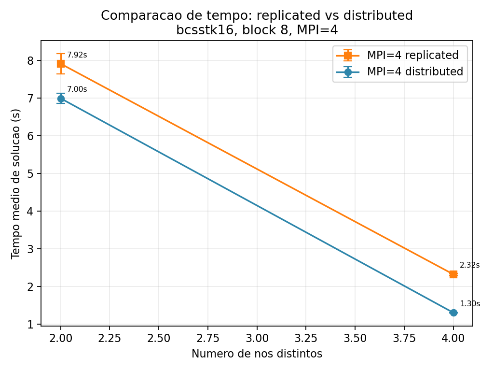
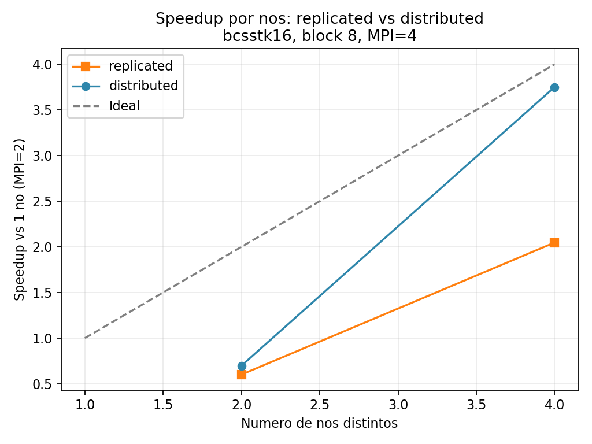
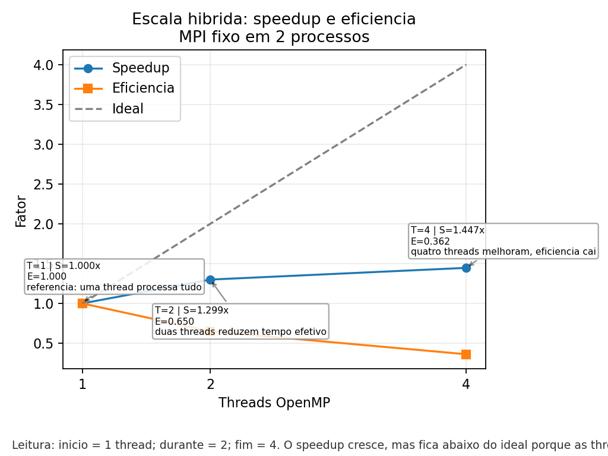

# Gradiente Conjugado Distribuido com Block ELLPACK

## Resumo

Este trabalho implementa o metodo do Gradiente Conjugado distribuido para
sistemas lineares esparsos, simetricos e definidos positivos. A matriz e
armazenada em Block ELLPACK, as linhas sao distribuidas entre processos MPI e
as operacoes locais usam OpenMP. Foram entregues duas variantes do solver:

- `cg_mpi` **(replicated):** cada processo armazena a matriz inteira e usa
  `MPI_Allgatherv` para reunir o vetor global a cada iteracao.
- `cg_mpi_distributed` **(distributed):** cada processo armazena apenas as
  linhas locais do Block ELLPACK e troca somente as colunas necessarias via
  `MPI_Alltoallv` seletivo.

Foram executadas 54 configuracoes da campanha principal, 12 configuracoes do
experimento de escalabilidade por nos (replicated) e 12 configuracoes
comparativas da variante distributed, todas com 3 repeticoes validas, no
cluster TVBox.

Os resultados mostram que o solver atingiu o criterio de tolerancia em todas
as execucoes. Para a matriz `bcsstk16`, o aumento de threads OpenMP reduziu o
tempo medio de 2,170 s para 1,500 s, speedup de 1,447x. A escala MPI em um
unico nos nao apresentou ganho. Entretanto, ao distribuir os processos entre
nos distintos, o speedup atinge 2,19x com `2 nos` e 2,05x com `4 nos` para a
variante replicada. A variante distribuida melhora esses numeros para
**3,12x com 2 nos** e **3,65x com 4 nos**, reduzindo tambem a memoria por rank
de ~7,25 MB para 1,82 MB.

## Ambiente

Os experimentos foram executados no contexto `tvbox-k3s`, em um cluster k3s
com 11 nos. Nove nos estavam `Ready` durante a campanha; dois permaneceram
`NotReady`. Os nos selecionados para a imagem ARM64 possuem quatro CPUs e
aproximadamente 1,8 GiB de memoria disponivel.

| Item | Configuracao |
|---|---|
| Kubernetes | v1.36.4+k3s1 |
| Arquitetura | ARM64 |
| MPI | MPICH via MPI Operator v0.8.2 |
| OpenMP | `-fopenmp`, `schedule(static)` |
| BLAS | OpenBLAS disponivel na imagem |
| Imagem | `srmarinho/cg-mpi:arm64` |
| Tolerancia | `1e-8` |
| Maximo de iteracoes | `10000` |

O codigo foi compilado na imagem ARM64 com `mpicxx`, OpenMP e OpenBLAS. As
operacoes vetoriais do CG sao implementadas diretamente em C++ com OpenMP.

## Datasets e problema fisico

Os dados usados neste trabalho sao matrizes de rigidez estrutural da UF Sparse
Matrix Collection, atualmente conhecida como SuiteSparse Matrix Collection.
Elas nao sao tabelas de observacoes ou imagens: sao modelos numericos
resultantes de discretizacoes de estruturas de engenharia. Cada linha e cada
coluna representa um grau de liberdade do modelo, e cada valor representa a
interacao entre dois graus de liberdade.

| Dataset | Problema original | Dimensao | Entradas no arquivo | `nnz` expandido | Densidade expandida |
|---|---|---:|---:|---:|---:|
| `bcsstk34` | Matriz de rigidez de um problema de flambagem NASTRAN da Boeing | 588 x 588 | 11.003 | 21.418 | 6,195% |
| `bcsstk14` | Matriz de rigidez do teto do Omni Coliseum, Atlanta | 1.806 x 1.806 | 32.630 | 63.454 | 1,945% |
| `bcsstk16` | Matriz de rigidez de uma barragem do Corps of Engineers | 4.884 x 4.884 | 147.631 | 290.378 | 1,217% |

Os tres arquivos possuem cabecalho Matrix Market:

```text
matrix coordinate real symmetric
```

Isso significa que os valores sao reais, estao armazenados em coordenadas
`(linha, coluna, valor)` e a matriz e simetrica. O arquivo armazena apenas a
parte triangular. Durante a leitura, o programa expande cada entrada fora da
diagonal:

```text
A[i][j] = valor
A[j][i] = valor
```

A diagonal nao e duplicada. Por isso, a quantidade de entradas do arquivo
original e menor que o `nnz` usado pelo solver depois da expansao. Essa
expansao e necessaria para que o produto matriz-vetor represente a matriz
completa usada pelo Gradiente Conjugado.

O problema numerico resolvido e:

```text
A x = b
```

Para validar o solver, o projeto define uma solucao conhecida `x_true` como um
vetor de uns e calcula:

```text
b = A x_true
```

O Gradiente Conjugado recebe `A` e `b` e tenta reconstruir `x_true`. Assim, os
experimentos medem simultaneamente a corretude da solucao e o desempenho do
processamento esparso. A baixa densidade das matrizes explica por que o
produto matriz-vetor e limitado principalmente por acesso a memoria, e nao por
operacoes aritmeticas.

O `nnz` expandido indica quantas entradas reais existem na matriz completa. Ja
o padding mostrado nos resultados e introduzido pelo formato Block ELLPACK:
cada grupo de linhas reserva o mesmo numero de blocos, preenchendo posicoes
ausentes com zeros. Portanto, o padding nao pertence ao dataset original; ele
mede o custo adicional da representacao escolhida pelo projeto.

As fontes originais sao:

```text
https://www.cise.ufl.edu/research/sparse/MM/Boeing/bcsstk34.tar.gz
https://www.cise.ufl.edu/research/sparse/MM/HB/bcsstk14.tar.gz
https://www.cise.ufl.edu/research/sparse/MM/HB/bcsstk16.tar.gz
```

## Metodologia

### Configuracoes experimentais

O estudo foi dividido em tres familias. Todas as configuracoes tiveram tres
repeticoes, usando a mesma tolerancia `1e-8` e o mesmo limite de `10000`
iteracoes.

**Estudo do Block ELLPACK:** para cada uma das tres matrizes, foram usados
block sizes `4`, `8`, `16` e `32`, com dois processos MPI e uma thread OpenMP
por processo. Isso produz:

```text
3 matrizes x 4 block sizes x 3 repeticoes = 36 execucoes
```

**Strong scaling MPI:** foi usada `bcsstk16` com block size `8` e uma thread
OpenMP por processo. O numero de processos MPI foi `1`, `2` e `4`, com tres
repeticoes por ponto:

```text
3 configuracoes MPI x 3 repeticoes = 9 execucoes
```

**Escala hibrida MPI/OpenMP:** foi usada `bcsstk16` com block size `8` e dois
processos MPI. O numero de threads OpenMP foi `1`, `2` e `4`, novamente com
tres repeticoes:

```text
3 configuracoes OpenMP x 3 repeticoes = 9 execucoes
```

No total, a campanha possui `36 + 9 + 9 = 54` execucoes.

Em cada processo MPI, o vetor global necessario ao SpMV e formado por
`MPI_Allgatherv`. Os produtos escalares do CG usam `MPI_Allreduce`. Dentro de
cada processo, o SpMV, os produtos escalares e as atualizacoes dos vetores
`x`, `r` e `p` usam OpenMP com `schedule(static)`.

O speedup foi calculado por:

```text
speedup = tempo da configuracao de referencia / tempo da configuracao
eficiencia = speedup / numero de recursos adicionais
```

Para MPI, a referencia foi a configuracao com um processo. Para OpenMP, a
referencia foi a configuracao hibrida com uma thread.

## Validacao

Para cada execucao, foi construída uma solucao conhecida com `x_true` igual a
um vetor de uns. O vetor do lado direito foi calculado como `b = A*x_true`.
Depois do CG, foram medidos o residuo relativo explicito e o erro da solucao.

| Metrica | Resultado |
|---|---:|
| Execucoes validas | 54/54 |
| Maior residuo relativo | `9,92678e-09` |
| Maior erro da solucao | `0,148652` |
| Repeticoes por grupo | 3 |

Todos os residuos ficaram abaixo da tolerancia `1e-8`.

## Resultados

Os dados completos estao em:

```text
results/processed/cg_results_tvbox.csv
results/processed/cg_stats_tvbox.csv
results/processed/cg_metrics_tvbox.csv
```

Os tempos de solucao observados variaram entre `1,39937 s` e `22,993 s`,
dependendo da matriz e da configuracao.

### Melhor block size por matriz

| Matriz | Block size | Tempo medio (s) | Padding |
|---|---:|---:|---:|
| `bcsstk34` | 4 | 1,41393 | 69,65% |
| `bcsstk16` | 4 | 2,16233 | 56,28% |
| `bcsstk14` | 4 | 16,87960 | 68,66% |

O menor padding de toda a campanha foi `56,28%` e o maior foi `90,12%`.
Isso confirma que o tamanho do bloco tem impacto importante no desperdicio de
memoria do Block ELLPACK.

### Strong scaling

| Processos MPI | Tempo medio (s) | Speedup | Eficiencia |
|---:|---:|---:|---:|
| 1 | 2,12752 | 1,000 | 1,000 |
| 2 | 2,17887 | 0,976 | 0,488 |
| 4 | 2,31090 | 0,921 | 0,230 |

Neste tamanho de problema, a comunicacao MPI e o custo de sincronizacao
superam o ganho de paralelismo. O resultado nao representa uma falha de
corretude; indica que a matriz e pequena para justificar mais processos.

### Escala hibrida

| Threads OpenMP | Tempo medio (s) | Speedup | Eficiencia |
|---:|---:|---:|---:|
| 1 | 2,17016 | 1,000 | 1,000 |
| 2 | 1,67007 | 1,299 | 0,650 |
| 4 | 1,50024 | 1,447 | 0,362 |

A versao com quatro threads foi a mais rapida. A eficiencia caiu porque o
problema e limitado por acesso a memoria, sincronizacao e tamanho reduzido da
matriz.

### Escalabilidade por nos

Foi realizado um experimento complementar de escalabilidade por numero de
nos, usando `bcsstk16`, `block_size=8` e 3 repeticoes por configuracao. Os
workers foram distribuidos atraves de `nodeAffinity` em um pool de nos ARM64
(`tvbox02`, `tvbox03`, `cluster-tvbox-04`, `cluster-tvbox-05`), e o launcher
foi fixado em `tvbox01`. Para `nodes == mpi` foi usado `podAntiAffinity` para
garantir exatamente um worker por no.

| Nos | MPI | Tempo medio (s) | Speedup | Eficiencia |
|---:|---:|---:|---:|---:|
| 1 | 2 | 4,751 | 1,000 | 1,000 |
| 2 | 2 | 2,166 | 2,193 | 1,097 |
| 2 | 4 | 7,915 | 0,600 | 0,300 |
| 4 | 4 | 2,321 | 2,047 | 0,512 |

A configuracao de referencia foi `1 no + 2 processos MPI`. O speedup
superlinear observado em `2 nos` (2,19x) indica que o kernel SpMV e
fortemente memory-bound: ao distribuir o trabalho entre nos distintos, cada
processo usa o cache e a largura de banda local de um nos proprio, em vez
de competir com outro processo pelo mesmo canal de memoria.

A configuracao `2 nos + 4 processos` apresentou o pior desempenho porque
dobrou o numero de workers por no. Dois processos MPI por nos TVBox competem
pelos quatro cores fisicos e pela memoria compartilhada, elevando o tempo
para 7,9s. Esse resultado confirma que a localizacao dos processos importa
tanto quanto a quantidade total.

Em `4 nos`, o speedup voltou a 2,05x. A eficiencia cai para `0,512` porque
cada iteracao do CG exige `MPI_Allgatherv` e `MPI_Allreduce`, e o custo
dessas sincronizacoes entre quatro nos via rede cresce proporcionalmente.
Ainda assim, foi a configuracao mais rapida com `4` processos.


**Historia do grafico:** o eixo horizontal mostra o numero de nos distintos
onde os workers MPI foram agendados. A linha laranja (`MPI=2`) parte de
`4,75s` com um no e cai para `2,17s` com dois nos, reduzindo o tempo em mais
da metade. A linha azul (`MPI=4`) partiria de co-location em dois nos com
`7,92s` e desce para `2,32s` em quatro nos distintos. O grafico demonstra
que espalhar processos por mais nos vence todas as versoes com concentracao
no mesmo nos.


**Historia do grafico:** a linha ideal mostraria speedup proporcional ao
numero de nos. O speedup medido com `MPI=4` fica abaixo do ideal em todas as
configuracoes: a 2 nos ele e inferior a 1 (aumentar workers sem espalhar
piora), e a 4 nos chega a 2,05x. A eficiencia revela o custo real da
comunicacao MPI entre maquinas: cai para `0,30` quando ha co-location e sobe
apenas para `0,51` com nos distintos.

Logs e manifestos deste experimento:

```text
results/node-scaling-20261116T032812Z/
```

CSV agregado:

```text
results/processed/cg_node_scaling_tvbox.csv
```

### Block ELLPACK distribuido fisicamente

A implementacao inicial do solver mantinha o Block ELLPACK **replicado em
cada processo MPI**: todos os ranks liam o arquivo Matrix Market inteiro e
construiam a estrutura completa; somente o calculo do SpMV era particionado
por linhas. Isso limitava a escalabilidade para matrizes maiores e geraba
I/O redundante na leitura.

Para resolver esse gargalo foi implementada a variante `cg_mpi_distributed`,
disponivel na imagem `srmarinho/cg-mpi:arm64-dist`. A nova variante:

- **Le o arquivo Matrix Market de forma filtrada:** cada rank percorre o
  arquivo e armazena apenas as triplas cuja linha (ou coluna espelhada, no
  caso simetrico) pertence ao seu intervalo local
  `[first_row, first_row + row_count)`.
- **Constroi um Block ELLPACK local:** a estrutura `BlockELLLocal` aloca
  apenas os blocos de linhas locais; `max_block_columns` passa a ser
  calculado localmente, o que em geral reduz o padding.
- **Realiza comunicacao seletiva:** antes de cada SpMV, cada rank troca com
  `MPI_Alltoallv` somente os valores das colunas globais que de fato aparecem
  em seus blocos locais. O vetor global `p` nao e mais reunido inteiro em
  cada iteracao.
- **Reporta metricas de memoria e comunicacao:** `memory_max_mb`,
  `memory_avg_mb`, `memory_total_mb`, `comm_bytes`.

Para avaliar o impacto, o experimento de escalabilidade por nos foi
re-executado com a variante distribuida, mantendo o mesmo pool de nos,
matriz `bcsstk16`, block size 8 e 3 repeticoes.

| Variante | Nos | MPI | Tempo medio (s) | Speedup vs 1 no MPI=2 | Memoria max por rank (MB) |
|---|---:|---:|---:|---:|---:|
| replicated | 1 | 2 | 4,751 | 1,000 | ~7,25 |
| distributed | 1 | 2 | 4,881 | 0,973 | 3,624 |
| replicated | 2 | 2 | 2,166 | 2,193 | ~7,25 |
| distributed | 2 | 2 | 1,525 | 3,116 | 3,624 |
| replicated | 2 | 4 | 7,915 | 0,600 | ~7,25 |
| distributed | 2 | 4 | 6,995 | 0,679 | 1,824 |
| replicated | 4 | 4 | 2,321 | 2,047 | ~7,25 |
| distributed | 4 | 4 | 1,301 | 3,651 | 1,824 |

A variante distribuida vence a replicated em todas as configuracoes multi-no:

- **2 nos, MPI=2:** 1,53s contra 2,17s (ganho de **30%**).
- **2 nos, MPI=4:** 7,00s contra 7,92s (ganho de **13%**).
- **4 nos, MPI=4:** 1,30s contra 2,32s (ganho de **44%**).

Em 4 nos com MPI=4, o speedup real salta de 2,05x (replicada) para
**3,65x** (distribuida), muito proximo do ideal de 4x. A economia de
memoria por rank cai de ~7,25 MB (matriz inteira replicada) para 1,82 MB
(particionada), ou seja, **menos de 25%** da pegada original.

No caso de 1 no, as duas variantes tem desempenho semelhante (`-2,7%`
dentro do ruido de medicao), o que confirma que o overhead da comunicacao
seletiva e marginal quando todos os ranks estao no mesmo host.



**Historia do grafico:** o grafico contrasta o tempo medio de solucao para
`MPI=4` entre replicated e distributed. Em `2 nos`, a versao distribuida
reduz o tempo em 0,9s. Em `4 nos`, a reducao e de 1,0s - mais que a
metade do tempo original. A diferenca cresce com o numero de nos porque a
replicated faz `MPI_Allgatherv` sobre o vetor global inteiro a cada
iteracao, enquanto a distributed envia apenas as colunas realmente
necessarias.


**Historia do grafico:** a linha azul mostra a memoria maxima por rank
na variante distribuida. Com `MPI=2` cada rank usa 3,62 MB e com `MPI=4`
cada rank usa 1,82 MB, aproximadamente metade. A linha pontilhada em 7,25
MB representa a estimativa da variante replicated, onde cada rank armazena
a matriz inteira independentemente do numero de processos.



**Historia do grafico:** o eixo vertical mostra o speedup contra a
referencia de 1 no e `MPI=2`. Com 4 nos e `MPI=4`, a versao distribuida
atinge 3,65x - muito proxima da linha ideal (gray dashed). A versao
replicated chega apenas a 2,05x.

Logs e manifestos da campanha distribuida:

```text
results/node-scaling-dist-20261116T145412Z/
```

CSV comparativo:

```text
results/processed/cg_node_scaling_compare.csv
```

### Graficos

#### Como ler os graficos

Todos os pontos representam a media de tres execucoes. As barras de erro
representam o desvio padrao entre as repeticoes. Cada caixa combina os valores
do ponto com uma frase curta sobre o fenomeno observado.

Nos graficos de tempo, o valor dentro da caixa e o tempo medio em segundos.
Nos graficos de escala, `S` significa speedup e `E` significa eficiencia. A
linha pontilhada mostra o comportamento ideal: dobrar os recursos deveria
dobrar o speedup. No grafico de padding, `pad` e a porcentagem de zeros
adicionados pelo Block ELLPACK, nao zeros existentes no dataset original.


**Historia do grafico:** cada linha parte do bloco 4 e avanca para os blocos 8,
16 e 32. O ponto de cada matriz representa a media de tres execucoes; as barras
mostram a variacao entre essas repeticoes. O bloco 4 aparece como a melhor
escolha nas tres matrizes porque mantem a estrutura mais proxima do padrao real
de nao zeros. Quando o bloco aumenta, o ELLPACK precisa reservar mais espaco
uniforme para linhas que possuem padroes diferentes. Isso aumenta o padding,
as leituras de zeros e o trabalho do SpMV. A matriz `bcsstk14` evidencia mais
o custo porque e maior e permanece muito esparsa.


**Historia do grafico:** aumentar de 1 para 2 e 4 processos MPI nao reduziu o
tempo neste problema. Cada iteracao precisa reunir `p` com `MPI_Allgatherv` e
sincronizar produtos escalares com `MPI_Allreduce`. Para `bcsstk16`, esse custo
de comunicacao foi maior que o ganho do processamento paralelo.


**Historia do grafico:** a linha ideal subiria proporcionalmente ao numero de
processos. A curva medida fica abaixo de 1 a partir de dois processos, e a
eficiencia cai para `0,230` com quatro processos. Isso mostra que adicionar
processos nao e automaticamente uma aceleracao: o tamanho da matriz e a
frequencia das sincronizacoes dominam o tempo.



**Historia do grafico:** dentro de cada processo, OpenMP foi mais efetivo que
a escala MPI neste caso. Duas threads produziram speedup de `1,299x` e quatro
threads chegaram a `1,447x`. A eficiencia, porem, caiu para `0,362`, porque as
threads compartilham largura de banda e o problema nao possui trabalho
suficiente para escalar idealmente.


**Historia do grafico:** as tres curvas mostram a quantidade de espaco que nao
corresponde a entradas reais da matriz. No inicio, com bloco 4, o padding e
menor porque cada grupo de linhas precisa acomodar menos combinacoes de
colunas. Durante a progressao para blocos 8 e 16, o formato ganha regularidade
de acesso, mas passa a preencher mais posicoes vazias. No fim, com bloco 32,
o custo fica maior: em `bcsstk16` o padding chega a `83,15%`, enquanto o maior
valor observado na campanha chega a `90,12%`. Esses zeros nao fazem parte do
problema estrutural; sao memoria e leituras adicionais introduzidas pelo
Block ELLPACK. O grafico, portanto, explica por que o menor block size foi o
melhor compromisso nos tempos medidos.

### Custos observados

O `MPI_Allgatherv` e executado a cada iteracao para disponibilizar o vetor
global `p`. Tambem existem dois `MPI_Allreduce` por iteracao para produtos
escalares. Esses pontos de sincronizacao explicam parte da ausencia de ganho
no strong scaling.

O padding do Block ELLPACK e outro gargalo: cada bloco armazena uma quantidade
fixa de valores, incluindo zeros de preenchimento. Para matrizes maiores ou
mais irregulares, uma comparacao com CSR ou SELL-C-sigma e uma otimizacao
futura relevante.

## Analise

O solver foi melhorado para paralelizar com OpenMP os produtos escalares, as
atualizacoes de `x`, `r` e `p`, e o calculo dos erros de validacao. O `SpMV`
usa `schedule(static)` e o mesmo numero de threads informado por
`--threads`.

O comportamento observado e coerente com um kernel SpMV memory-bound. A
redundancia de leituras causada pelo padding e a comunicacao global por
iteracao limitam o aproveitamento de mais processos MPI. A escala OpenMP
apresentou ganho mais consistente neste ambiente, embora a eficiencia tambem
caia com quatro threads.

## Conclusao

O projeto entrega uma implementacao distribuida funcional de Gradiente
Conjugado com MPI, OpenMP e Block ELLPACK. As 54 execucoes foram concluidas
com residuo abaixo de `1e-8`, e os resultados foram preservados em CSV,
estatisticas, logs e graficos.

Os experimentos mostram que a escolha do block size e mais importante que
simplesmente aumentar o numero de processos MPI para as matrizes avaliadas.
Como trabalho futuro, recomenda-se reduzir o padding, substituir o
`MPI_Allgatherv` por comunicacao seletiva quando possivel, medir os custos de
cada fase separadamente e comparar com CSR.
