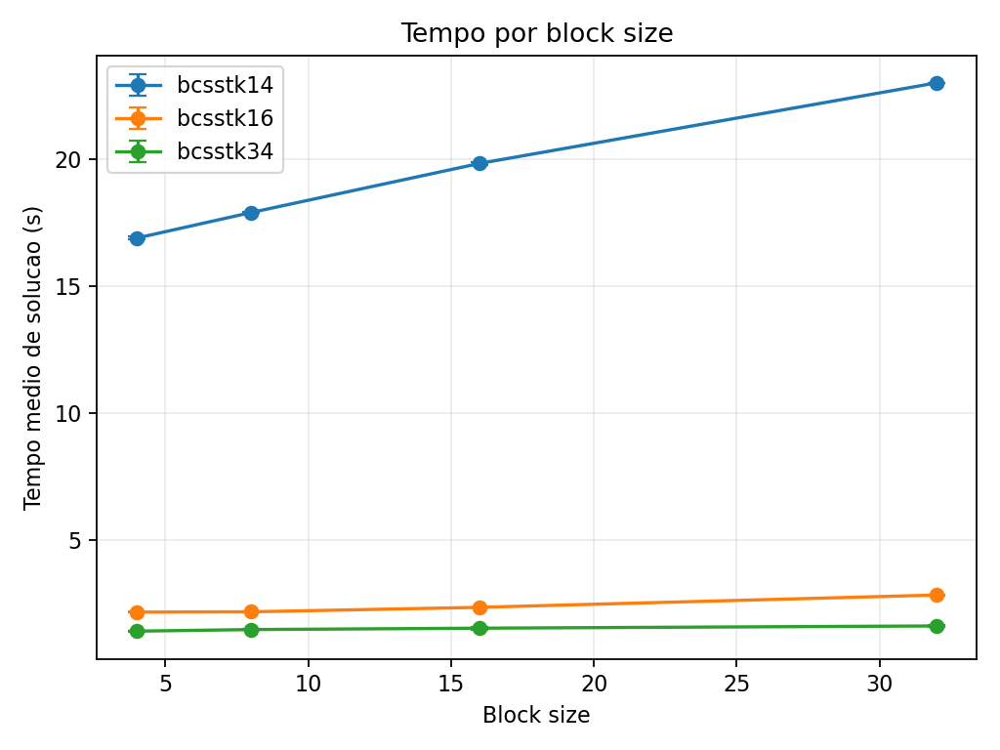
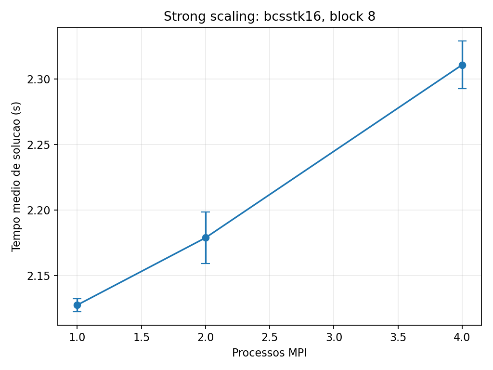

# Gradiente Conjugado Distribuido com Block ELLPACK

## Resumo

Este trabalho implementa o metodo do Gradiente Conjugado distribuido para
sistemas lineares esparsos, simetricos e definidos positivos. A matriz e
armazenada em Block ELLPACK, as linhas sao distribuidas entre processos MPI e
as operacoes locais usam OpenMP. Foram executadas 54 configuracoes, todas com
3 repeticoes validas, no cluster TVBox.

Os resultados mostram que o solver atingiu o criterio de tolerancia em todas
as execucoes. Para a matriz `bcsstk16`, o aumento de threads OpenMP reduziu o
tempo medio de 2,170 s para 1,500 s, speedup de 1,447x. A escala MPI nao
apresentou ganho neste problema pequeno: 1 processo levou 2,128 s e 4
processos levaram 2,311 s.

## Ambiente

Os experimentos foram executados no contexto `tvbox-k3s`, em um cluster k3s
com 11 nos. Nove nos estavam `Ready` durante a campanha; dois permaneceram
`NotReady`. Os nos selecionados para a imagem ARM64 possuem quatro CPUs e
aproximadamente 1,8 GiB de memoria disponivel.

| Item | Configuracao |
|---|---|
| Kubernetes | v1.36.4+k3s1 |
| Arquitetura | ARM64 |
| MPI | MPICH via MPI Operator v0.8.2 |
| OpenMP | `-fopenmp`, `schedule(static)` |
| BLAS | OpenBLAS disponivel na imagem |
| Imagem | `srmarinho/cg-mpi:arm64` |
| Tolerancia | `1e-8` |
| Maximo de iteracoes | `10000` |

O codigo foi compilado na imagem ARM64 com `mpicxx`, OpenMP e OpenBLAS. As
operacoes vetoriais do CG sao implementadas diretamente em C++ com OpenMP.

## Metodologia

Foram usadas as matrizes SuiteSparse preservadas no repositorio:

```text
bcsstk34, bcsstk14, bcsstk16
```

O estudo de Block ELLPACK usou blocos `4`, `8`, `16` e `32`, com dois
processos MPI, uma thread OpenMP e tres repeticoes por configuracao. O estudo
de strong scaling usou `bcsstk16`, bloco `8`, uma thread e `1`, `2` e `4`
processos MPI. O estudo hibrido manteve dois processos MPI e variou entre
`1`, `2` e `4` threads OpenMP.

O speedup foi calculado por:

```text
speedup = tempo da configuracao de referencia / tempo da configuracao
eficiencia = speedup / numero de recursos adicionais
```

Para MPI, a referencia foi a configuracao com um processo. Para OpenMP, a
referencia foi a configuracao hibrida com uma thread.

## Validacao

Para cada execucao, foi construída uma solucao conhecida com `x_true` igual a
um vetor de uns. O vetor do lado direito foi calculado como `b = A*x_true`.
Depois do CG, foram medidos o residuo relativo explicito e o erro da solucao.

| Metrica | Resultado |
|---|---:|
| Execucoes validas | 54/54 |
| Maior residuo relativo | `9,92678e-09` |
| Maior erro da solucao | `0,148652` |
| Repeticoes por grupo | 3 |

Todos os residuos ficaram abaixo da tolerancia `1e-8`.

## Resultados

Os dados completos estao em:

```text
results/processed/cg_results_tvbox.csv
results/processed/cg_stats_tvbox.csv
results/processed/cg_metrics_tvbox.csv
```

Os tempos de solucao observados variaram entre `1,39937 s` e `22,993 s`,
dependendo da matriz e da configuracao.

### Melhor block size por matriz

| Matriz | Block size | Tempo medio (s) | Padding |
|---|---:|---:|---:|
| `bcsstk34` | 4 | 1,41393 | 69,65% |
| `bcsstk16` | 4 | 2,16233 | 56,28% |
| `bcsstk14` | 4 | 16,87960 | 68,66% |

O menor padding de toda a campanha foi `56,28%` e o maior foi `90,12%`.
Isso confirma que o tamanho do bloco tem impacto importante no desperdicio de
memoria do Block ELLPACK.

### Strong scaling

| Processos MPI | Tempo medio (s) | Speedup | Eficiencia |
|---:|---:|---:|---:|
| 1 | 2,12752 | 1,000 | 1,000 |
| 2 | 2,17887 | 0,976 | 0,488 |
| 4 | 2,31090 | 0,921 | 0,230 |

Neste tamanho de problema, a comunicacao MPI e o custo de sincronizacao
superam o ganho de paralelismo. O resultado nao representa uma falha de
corretude; indica que a matriz e pequena para justificar mais processos.

### Escala hibrida

| Threads OpenMP | Tempo medio (s) | Speedup | Eficiencia |
|---:|---:|---:|---:|
| 1 | 2,17016 | 1,000 | 1,000 |
| 2 | 1,67007 | 1,299 | 0,650 |
| 4 | 1,50024 | 1,447 | 0,362 |

A versao com quatro threads foi a mais rapida. A eficiencia caiu porque o
problema e limitado por acesso a memoria, sincronizacao e tamanho reduzido da
matriz.

### Graficos






### Custos observados

O `MPI_Allgatherv` e executado a cada iteracao para disponibilizar o vetor
global `p`. Tambem existem dois `MPI_Allreduce` por iteracao para produtos
escalares. Esses pontos de sincronizacao explicam parte da ausencia de ganho
no strong scaling.

O padding do Block ELLPACK e outro gargalo: cada bloco armazena uma quantidade
fixa de valores, incluindo zeros de preenchimento. Para matrizes maiores ou
mais irregulares, uma comparacao com CSR ou SELL-C-sigma e uma otimizacao
futura relevante.

## Analise

O solver foi melhorado para paralelizar com OpenMP os produtos escalares, as
atualizacoes de `x`, `r` e `p`, e o calculo dos erros de validacao. O `SpMV`
usa `schedule(static)` e o mesmo numero de threads informado por
`--threads`.

O comportamento observado e coerente com um kernel SpMV memory-bound. A
redundancia de leituras causada pelo padding e a comunicacao global por
iteracao limitam o aproveitamento de mais processos MPI. A escala OpenMP
apresentou ganho mais consistente neste ambiente, embora a eficiencia tambem
caia com quatro threads.

## Conclusao

O projeto entrega uma implementacao distribuida funcional de Gradiente
Conjugado com MPI, OpenMP e Block ELLPACK. As 54 execucoes foram concluidas
com residuo abaixo de `1e-8`, e os resultados foram preservados em CSV,
estatisticas, logs e graficos.

Os experimentos mostram que a escolha do block size e mais importante que
simplesmente aumentar o numero de processos MPI para as matrizes avaliadas.
Como trabalho futuro, recomenda-se reduzir o padding, substituir o
`MPI_Allgatherv` por comunicacao seletiva quando possivel, medir os custos de
cada fase separadamente e comparar com CSR.
